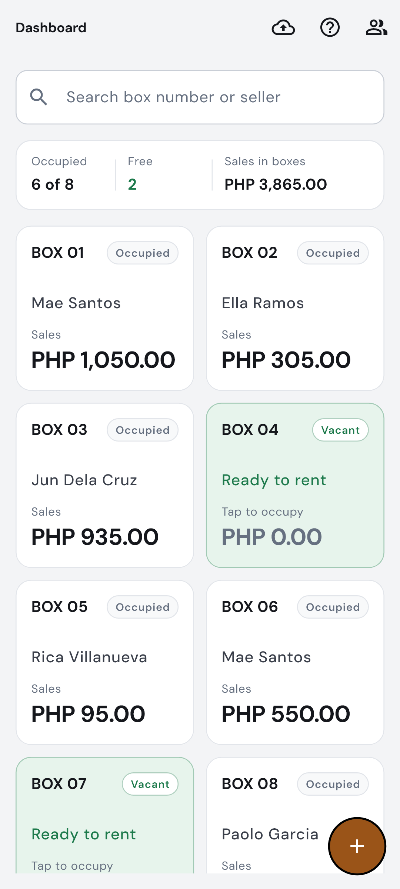
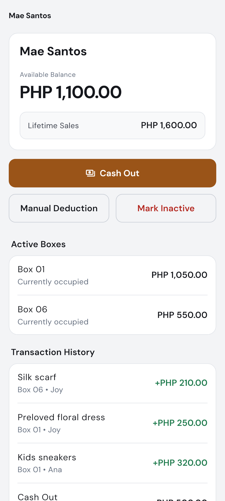
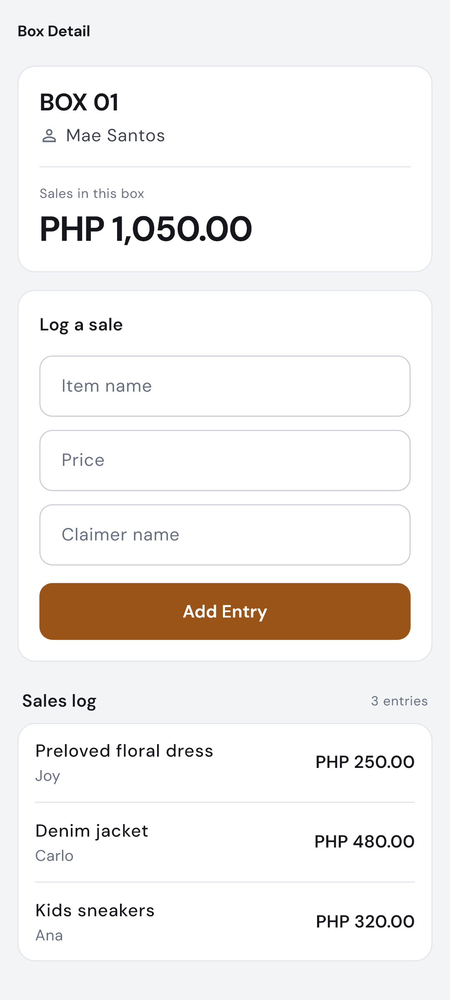
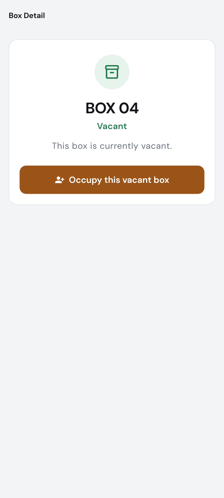
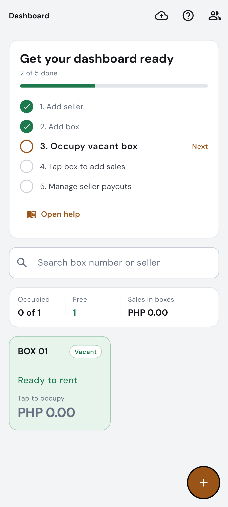

# Espasyo

[](https://github.com/jiggy025/rent-a-box-sys/actions/workflows/android-apk.yml)


Espasyo is a local-first Android app for box rental stores, kiosks, and shared selling spaces. It helps cashiers and store owners manage sellers, boxes, sales logs, balances, cash-outs, manual deductions, and backups from one simple Flutter app.

The project is built around real counter work: fast box assignment, quick vacancy checks, 52 px touch targets for one-handed operation, offline-first SQLite records, and automatic cloud backups to Google Drive.

<p align="center">
  
  &nbsp;&nbsp;
  
</p>

## Highlights

- **Local-first storage with Drift and SQLite**: Daily sales and counter operations run 100% offline with zero latency.
- **Counter-Tool UI Design**: 52 px controls, high-contrast typography in bundled DM Sans, and tabular figures for monetary alignment.
- **Live Setup Checklist**: Step-by-step onboarding guide that ticks off automatically as sellers, boxes, and sales are added.
- **Real-time Box & Vacancy Management**: Color-coded box states (white for occupied, green for vacant "ready to rent") with one-tap occupancy.
- **Per-box Sales Logging**: Fast entry for item name, price, and claimer details with running totals.
- **Seller Ledger & Payouts**: Clear tracking of available balance, lifetime sales, cash-out workflows, and audit history.
- **Local Snapshots & Google Drive Backup**: Instant local SQLite backups with optional synchronization to Google Drive's hidden `appDataFolder`.
- **Dual-Architecture Release APKs**: Automated GitHub Actions CI producing signed release builds for arm64 (phones) and x86_64 (emulators).

## Showcase

| Counter Dashboard | Seller Ledger & Payouts |
| --- | --- |
|  |  |
| **Summary metrics, occupied boxes, and vacant rental cards** | **Available balance, lifetime sales, and cash-out action** |

| Box Detail & Sales Log | Vacant Box Flow |
| --- | --- |
|  |  |
| **Per-box active sales logging and divided ledger** | **Instant vacancy check and fast rental assignment** |

| Live Setup Checklist |
| --- |
|  |
| **Interactive setup guide that ticks off as records are created** |

## Tech Stack

- **Framework**: Flutter 3.x & Dart
- **State Management**: Riverpod
- **Database & Persistence**: Drift with SQLite
- **Typography**: Bundled DM Sans (OFL) with Medium, SemiBold, and Bold weights
- **Cloud Sync**: Google Drive API (`appDataFolder`) & Google Sign-In
- **CI/CD**: GitHub Actions (automated testing, keystore restoration, and release APK packaging)

## Getting Started

Install Flutter, clone the repository, then fetch packages:

```powershell
flutter pub get
```

Run the app on an Android emulator or device:

```powershell
flutter run
```

Run the test suite:

```powershell
flutter test
```

Build an optimized release APK:

```powershell
flutter build apk --release --target-platform android-arm64,android-x64
```

The APK is generated at:

```text
build/app/outputs/flutter-apk/app-release.apk
```

## Google Drive Backups

Espasyo can back up data locally first, then upload pending backups to Google Drive when the user connects an account. Drive backups use Google Drive's hidden `appDataFolder`, so backup files do not appear in the normal Google Drive web interface.

To enable Drive backup for your own build, configure an Android OAuth client with your package name and signing SHA-1. See [Google Drive Backup Setup](docs/google-drive-setup.md).

## Versioning

This project uses semantic versioning through Flutter's `version` field:

```yaml
version: 1.0.0+1
```

The format is `MAJOR.MINOR.PATCH+BUILD`. Public release notes live in [CHANGELOG.md](CHANGELOG.md), and Git tags should follow the `vMAJOR.MINOR.PATCH` format.

## Security

No API keys, OAuth client secrets, signing keystores, `.env` files, APKs, or local build artifacts should be committed. The repository includes ignore rules for common local secrets and generated release files.

Google Drive authentication is configured by the developer in Google Cloud. The app requests only:

```text
https://www.googleapis.com/auth/drive.appdata
```

## License

Espasyo is open source under the [MIT License](LICENSE).
