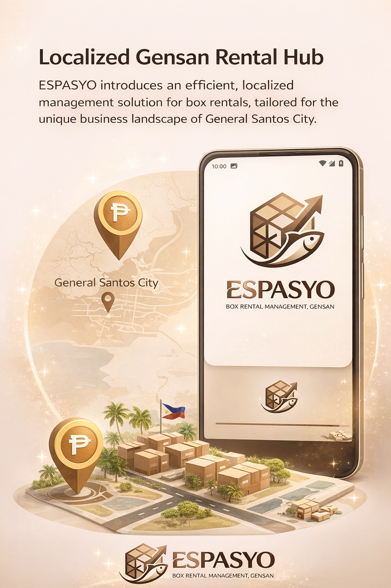
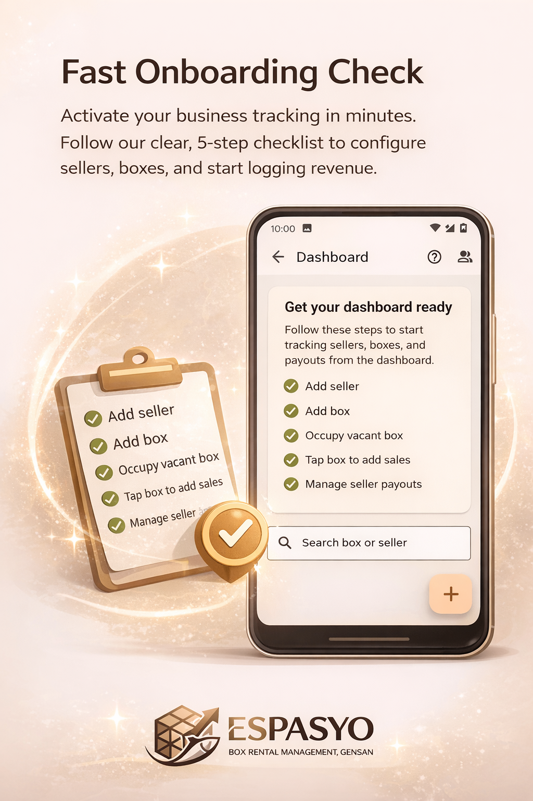
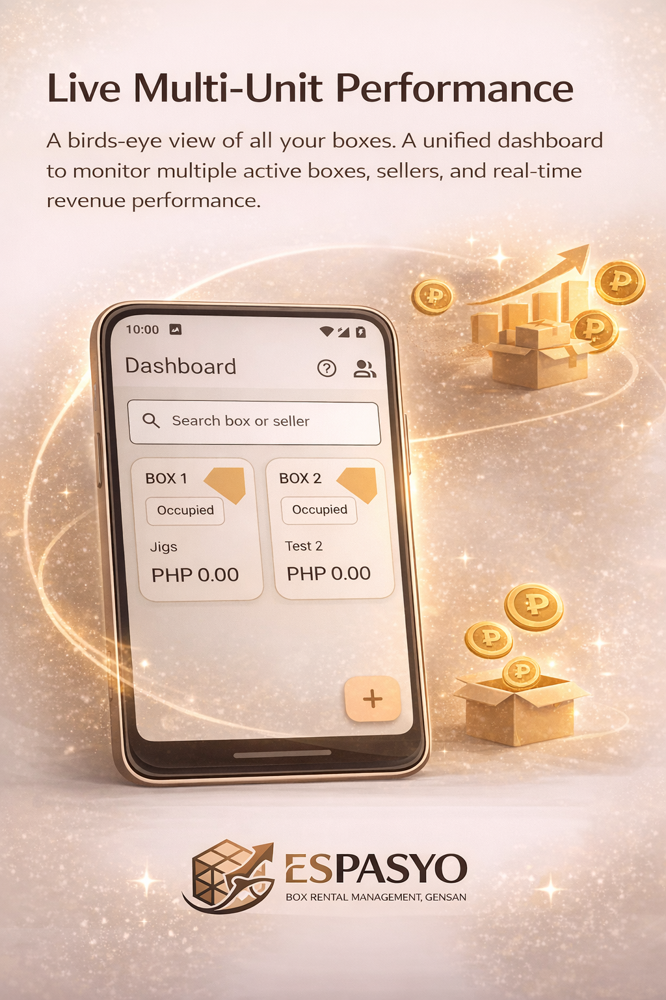
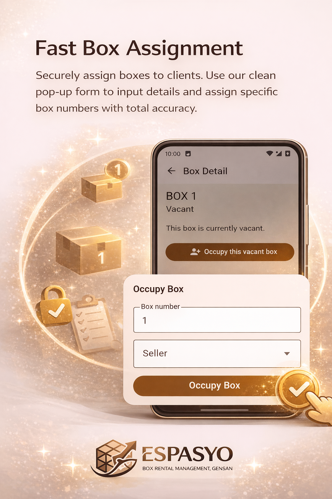
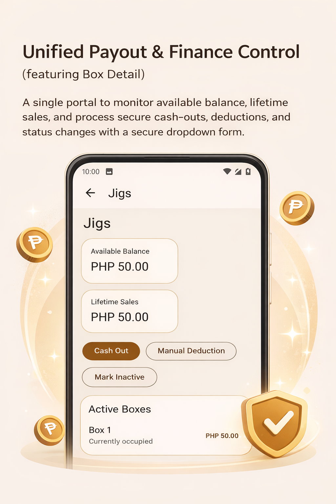
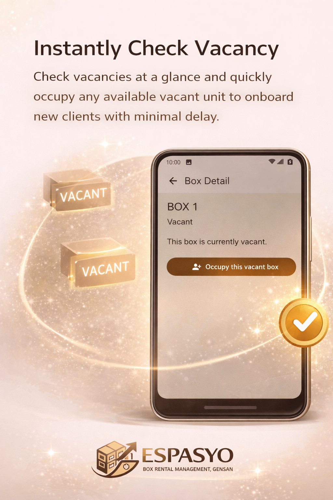
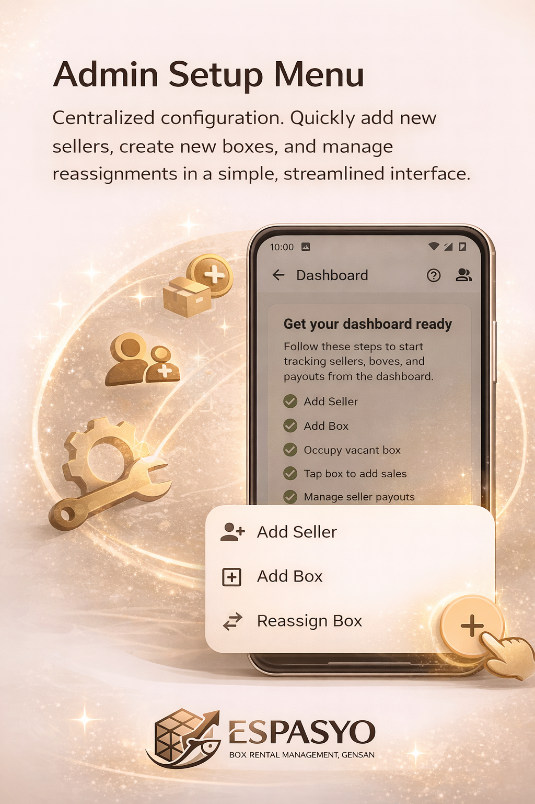

# Espasyo


Espasyo is a local-first Android app for box rental stores, kiosks, and shared selling spaces. It helps cashiers and store owners manage sellers, boxes, sales logs, balances, cash-outs, manual deductions, and backups from one simple Flutter app.

The project was designed around real counter work: quick seller lookup, fast box assignment, offline records, and recoverable data through local SQLite snapshots plus optional Google Drive app-data backups.

<p align="center">
  
</p>

## Highlights

- Local-first storage with Drift and SQLite, so daily sales work continues offline.
- Seller and box management for stores where one seller may rent multiple boxes.
- Per-box sales logging with item name, price, and claimer details.
- Seller balances, lifetime sales, cash-outs, and manual deductions.
- Vacant box flow for quickly occupying available boxes.
- Assignment history and transaction history for cleaner records.
- Local backup snapshots with optional Google Drive app-data upload and restore.
- Android-focused release build with arm64 APK support.

## Showcase

| Onboarding | Dashboard |
| --- | --- |
|  |  |

| Sales Logging | Box Assignment |
| --- | --- |
|  |  |

| Finance Control | Seller Reports |
| --- | --- |
|  |  |

| Vacancy Check | Admin Setup |
| --- | --- |
|  |  |

| Profitability |
| --- |
|  |

## Tech Stack

- Flutter and Dart
- Riverpod for state management
- Drift over SQLite for local persistence
- Google Sign-In and Google Drive API for optional cloud backup
- Android arm64 APK builds

## Getting Started

Install Flutter, clone the repository, then fetch packages:

```powershell
flutter pub get
```

Run the app on an Android emulator or device:

```powershell
flutter run
```

Run the test suite:

```powershell
flutter test
```

Build an optimized arm64 release APK:

```powershell
flutter build apk --release --target-platform android-arm64 --split-per-abi --obfuscate --split-debug-info=build/symbols
```

The APK is generated at:

```text
build/app/outputs/flutter-apk/app-arm64-v8a-release.apk
```

## Google Drive Backups

Espasyo can back up data locally first, then upload pending backups to Google Drive when the user connects an account. Drive backups use Google Drive's hidden `appDataFolder`, so backup files do not appear in the normal Google Drive web interface.

To enable Drive backup for your own build, configure an Android OAuth client with your package name and signing SHA-1. See [Google Drive Backup Setup](docs/google-drive-setup.md).

## Versioning

This project uses semantic versioning through Flutter's `version` field:

```yaml
version: 1.0.0+1
```

The format is `MAJOR.MINOR.PATCH+BUILD`. Public release notes live in [CHANGELOG.md](CHANGELOG.md), and Git tags should follow the `vMAJOR.MINOR.PATCH` format.

## Security

No API keys, OAuth client secrets, signing keystores, `.env` files, APKs, or local build artifacts should be committed. The repository includes ignore rules for common local secrets and generated release files.

Google Drive authentication is configured by the developer in Google Cloud. The app requests only:

```text
https://www.googleapis.com/auth/drive.appdata
```

## License

Espasyo is open source under the [MIT License](LICENSE).
